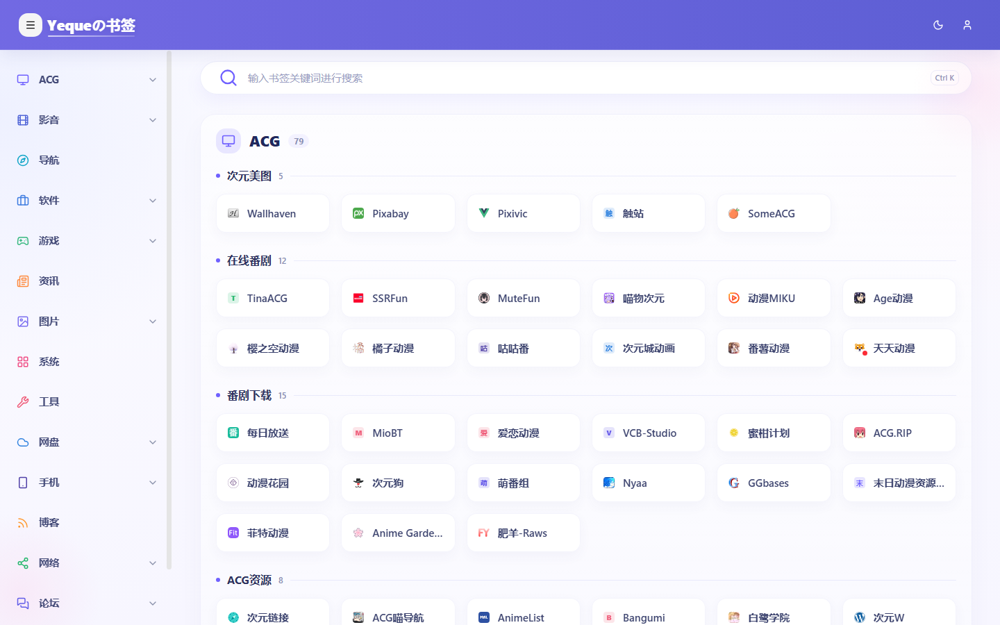
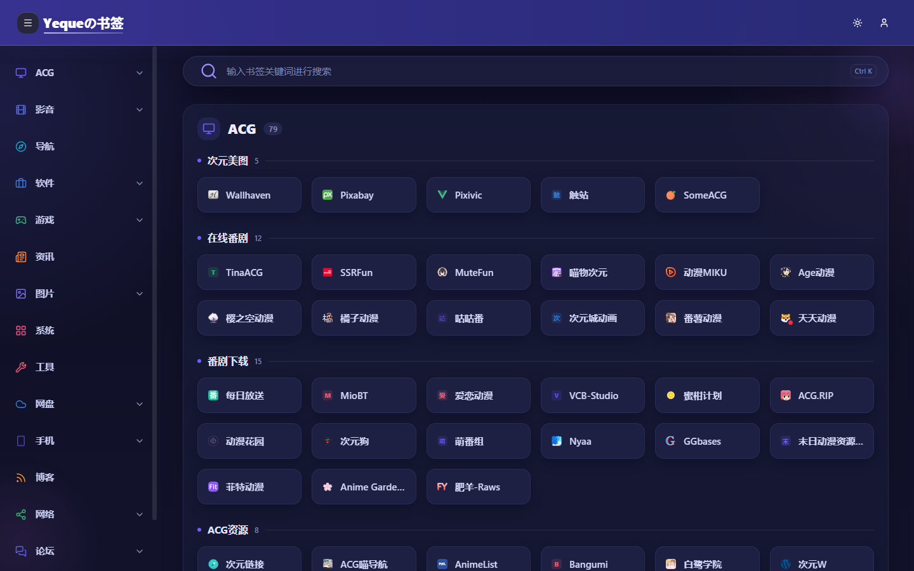
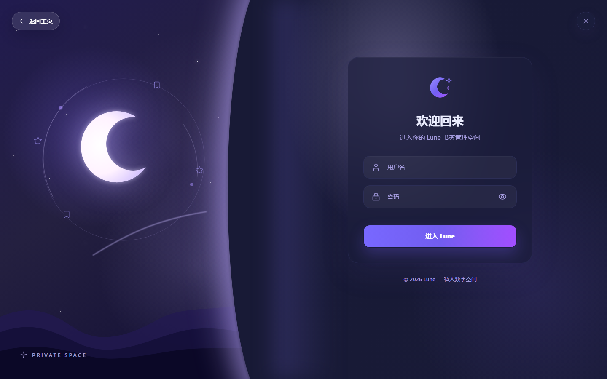
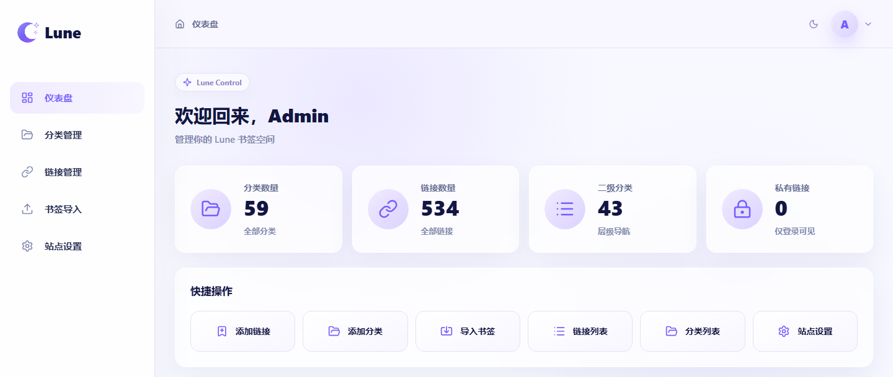
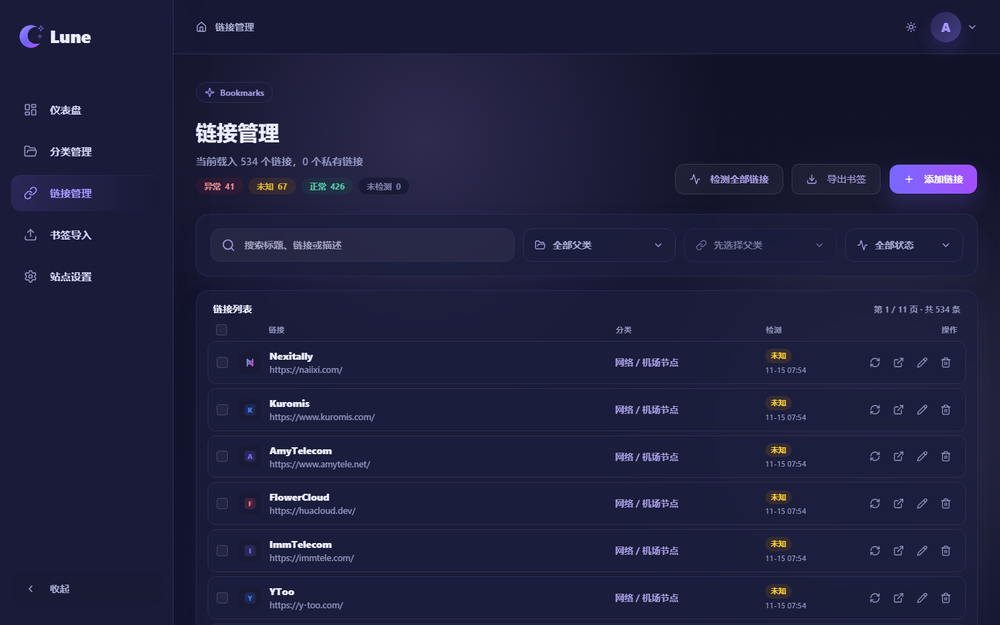

# Lune

私人书签导航管理器。从 PHP + SQLite3 重构为 Next.js + TypeScript + Prisma + Tailwind CSS + shadcn/ui。



<table>
  <tr>
    <td width="50%"></td>
    <td width="50%"></td>
  </tr>
  <tr>
    <td align="center">首页 · 深色模式</td>
    <td align="center">登录页</td>
  </tr>
  <tr>
    <td width="50%"></td>
    <td width="50%"></td>
  </tr>
  <tr>
    <td align="center">后台仪表盘</td>
    <td align="center">链接管理 · 探活状态</td>
  </tr>
</table>

## 技术栈

| 层 | 技术 |
|---|---|
| 框架 | Next.js 16 (App Router) |
| 语言 | TypeScript |
| 数据库 | SQLite (via better-sqlite3) |
| ORM | Prisma 5 |
| 样式 | Tailwind CSS v4 + shadcn/ui |
| 主题 | next-themes（全站深浅色） |
| 图标 | lucide-react |
| 认证 | HMAC 签名的 Session Cookie，密码以 bcrypt 存储 |

## 功能要点

- **深色模式**：首页、登录页和后台都支持深浅色，默认跟随系统，可手动切换，切换时用 View Transitions 渐变过渡（系统开启减少动效时跳过）。颜色全部定义为 `src/app/globals.css` 里的 CSS 变量。
- **站点图标**：没有自定义图标的链接通过 `/site-icon` 由服务端代理获取 favicon；取不到时显示按域名着色的首字母头像。
- **搜索**：首页按标题、描述和 URL 搜索。`Ctrl/⌘ + K` 或 `/` 聚焦，`Esc` 清除。
- **侧栏导航**：首页滚动到某个分类时自动展开侧栏对应分组，离开后收起，可在站点设置里关闭。
- **链接探活**：后台「链接管理」可批量或逐条检测链接，结果分为正常、异常、未知（WAF/防爬拦截或非 HTTP 链接）和未检测，可按状态筛选。检测从服务器发出，服务器访问不到的内网或地区限制站点可能显示为异常。修改 URL 后会重置并自动重测。检测为异常的链接会在首页图标右下角显示小红点，可在站点设置里关闭。
- **批量管理**：后台可勾选多条链接，批量检测、移动分类、设为公开或私有、删除。
- **移动端**：首页和后台都适配窄屏，后台在手机上用抽屉式导航。
- **书签导入导出**：后台可导入浏览器书签，也可通过 `/api/links/export` 导出为浏览器书签 HTML。

## 项目结构

```
src/
├── app/                        # Next.js App Router
│   ├── layout.tsx              # 根布局
│   ├── page.tsx                # 公开首页（RSC）
│   ├── login/page.tsx          # 登录页
│   ├── admin/                  # 后台管理
│   │   ├── layout.tsx
│   │   ├── page.tsx            # 仪表盘
│   │   ├── categories/page.tsx # 分类 CRUD
│   │   ├── links/page.tsx      # 链接 CRUD
│   │   ├── import/page.tsx     # 书签导入
│   │   └── settings/site/page.tsx
│   ├── api/                    # API 路由
│   │   ├── auth/               # 登录/登出
│   │   ├── categories/         # 分类 CRUD
│   │   ├── links/              # 链接 CRUD、探活（check/）、批量操作（batch/）、书签导出（export/）
│   │   └── settings/site/      # 站点配置
│   ├── click/[id]/             # 链接点击重定向
│   └── site-icon/              # favicon 代理
├── components/
│   ├── public/                 # 前台组件
│   ├── admin/                  # 后台组件
│   ├── shared/                 # 共享组件（主题等）
│   └── ui/                     # shadcn/ui 组件
├── lib/                        # 工具库
│   ├── prisma.ts               # Prisma 客户端单例
│   ├── auth.ts                 # Session 签发与校验
│   ├── auth-server.ts          # 登录校验、API/页面鉴权
│   ├── category-*.ts           # 分类层级与可见性
│   ├── public-homepage-data.ts # 首页数据与搜索
│   ├── bookmark-export.ts      # 书签 HTML 导出
│   ├── link-check.ts           # 链接探活与状态判定
│   ├── favicon*.ts             # 图标来源解析与上游占位图识别
│   ├── icons.ts                # 图标映射
│   └── utils.ts                # 通用工具
├── types/                      # TypeScript 类型
└── proxy.ts                    # 认证中间件（Next.js 16 proxy）
prisma/
├── schema.prisma               # 数据模型
└── onenav.db                   # SQLite 数据库文件
scripts/
├── migrate.ts                  # 数据迁移脚本
└── normalize-category-roots.ts # 根分类 fid=0 → NULL 修正
tests/                          # node:test 测试（npm test）
```

## 数据库模型

三张核心表：

- **on_categorys** — 分类（id, name, fid/parent_id, weight, property, font_icon）
- **on_links** — 书签链接（id, fid/category_id, title, url, description, weight, property, check_status, last_checked_time）
- **on_options** — 键值配置（key, value）

## 快速开始

### 安装

```bash
npm install
```

### 配置认证密钥

`AUTH_SECRET` 是登录 Session 签名所必需的环境变量，必须是至少 32 个随机字节。复制 `.env.example` 为 `.env`，然后使用以下跨平台命令生成密钥：

```bash
node -e "console.log(require('crypto').randomBytes(32).toString('base64url'))"
```

将输出写入 `.env` 的 `AUTH_SECRET`，不要提交真实密钥。缺失、空白或不足 32 UTF-8 字节时，登录和 Session 验证会 fail closed。轮换 `AUTH_SECRET` 会立即使全部现有 Session 失效，所有用户需要重新登录。

### 数据迁移（从旧 PHP 项目）

```bash
# 确保 Old Reference Project 目录存在于项目根目录
npx tsx scripts/migrate.ts
```

旧数据里根分类的 `fid = 0` 会让首页为空，需要改成 `NULL`。先 dry-run 查看，再按输出提示带 `--apply --backup <路径> --expected-sha256 <值>` 执行（数据库须在本地磁盘）：

```bash
npx tsx scripts/normalize-category-roots.ts --database <数据库绝对路径>
```

### 初始化数据库（无旧数据）

```bash
npx prisma db push
```

### 日常使用（推荐）

```bash
npm run build && npm start
```

生产模式下所有页面预编译，响应时间 **1-30ms**，等同原 PHP 项目体验。

### 精简部署（standalone）

`next.config.ts` 启用了 `output: 'standalone'`，构建后会生成 `.next/standalone/`，只含运行所需的文件，服务器上无需源码和完整 `node_modules`（线上即按此方式部署）。standalone 包默认不含静态资源，需要先复制进去再启动：

```bash
npm run build
cp -r public .next/standalone/ && cp -r .next/static .next/standalone/.next/
node .next/standalone/server.js
```

运行时仍需 `DATABASE_URL`、`AUTH_SECRET` 等环境变量；端口和监听地址用 `PORT`、`HOSTNAME` 指定。启用 standalone 后 `npm start` 仍可本地使用，但 Next 会提示改用 `server.js`。

### 开发模式

```bash
npm run dev
```

开发模式支持热更新（HMR）。首次访问每个页面有编译延迟（正常现象），后续访问即时响应。项目在网络共享盘上时需设置 `WATCHPACK_POLLING=true`，否则页面可能空白。

> **注意**: 当前 Windows 环境下 Turbopack 与 Prisma 存在 symlink 兼容问题，`dev` 和 `build` 脚本已固定使用 `--webpack`。

### 测试

```bash
npm test
```

## 路由总览

| 路由 | 类型 | 说明 |
|------|------|------|
| `/` | SSR | 公开首页，展示分类和链接卡片 |
| `/login` | Client | 登录页 |
| `/admin` | Client | 后台仪表盘（需登录） |
| `/admin/categories` | Client | 分类管理 |
| `/admin/links` | Client | 链接管理 |
| `/admin/import` | Client | 书签导入 |
| `/admin/settings/site` | Client | 站点设置 |
| `/click/[id]` | SSR | 链接点击跳转 |
| `/site-icon?u=<origin>` | Route Handler | favicon 代理；无图标时返回 204 |

## API 端点

| 端点 | 方法 | 说明 |
|------|------|------|
| `/api/auth/login` | POST | 登录 |
| `/api/auth/logout` | POST | 登出 |
| `/api/categories` | GET/POST | 分类列表/创建 |
| `/api/categories/[id]` | GET/PUT/DELETE | 单个分类 CRUD |
| `/api/links` | GET/POST | 链接列表/创建 |
| `/api/links/[id]` | GET/PUT/DELETE | 单个链接 CRUD |
| `/api/links/export` | GET | 导出浏览器书签 HTML |
| `/api/links/check` | POST | 检测一批链接（`{ ids }`，最多 50 个）并写回状态 |
| `/api/links/batch` | POST | 批量删除、移动分类或修改可见性（`{ action, ids }`，最多 1000 个） |
| `/api/settings/site` | GET/PUT | 站点设置 |

所有 `/api/*` 端点和 `/admin/*` 路由受代理认证保护，仅 `/api/auth/login`、`/api/auth/logout` 公开；各 API 路由内部还会再次校验 Session。

## 认证

登录成功后，服务端用 `AUTH_SECRET` 对 Session 载荷（用户名、签发和过期时间）做 HMAC-SHA256 签名，写入 httpOnly、`SameSite=Lax` 的 `onenav_token` Cookie（生产环境带 `Secure`，30 天有效期）。服务端不保存 Session，校验只依赖签名和过期时间，因此轮换 `AUTH_SECRET` 会让所有 Session 失效。

密码以 bcrypt 存储；首次登录时自动将旧项目的 MD5 哈希升级为 bcrypt。
